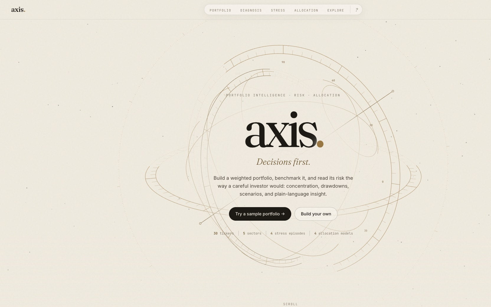
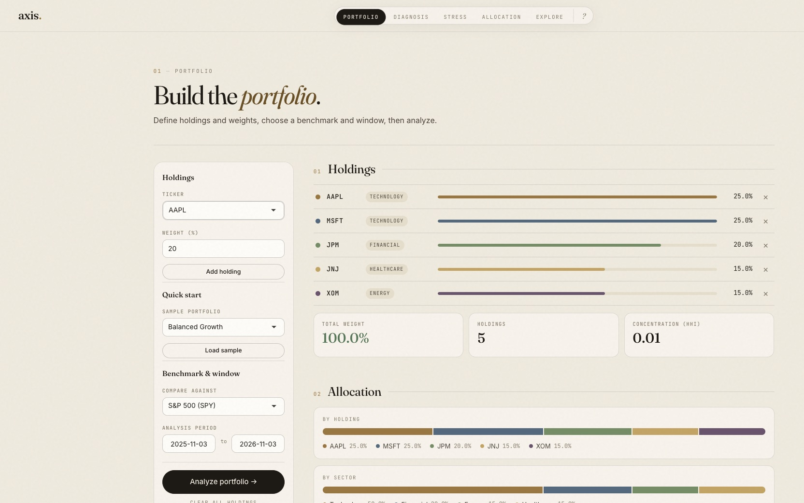
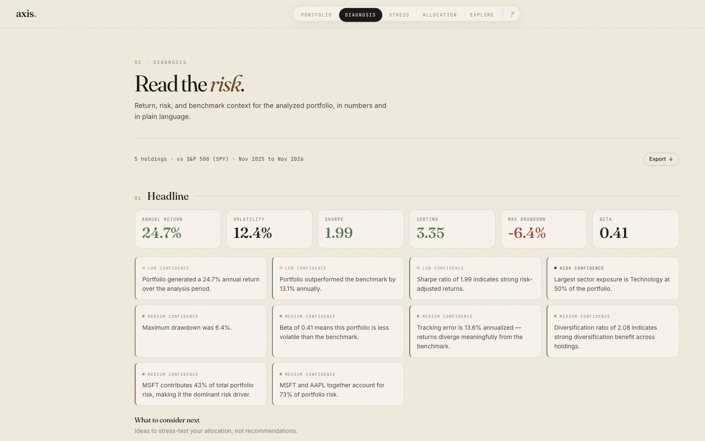
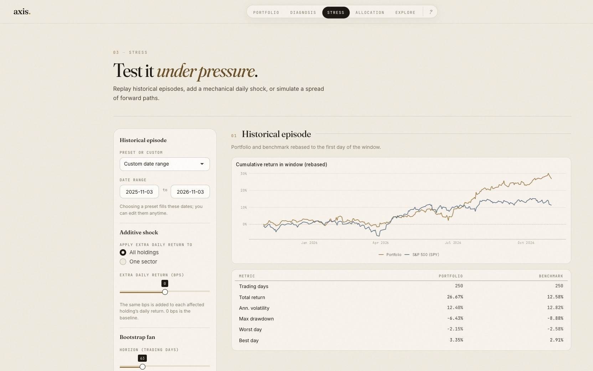
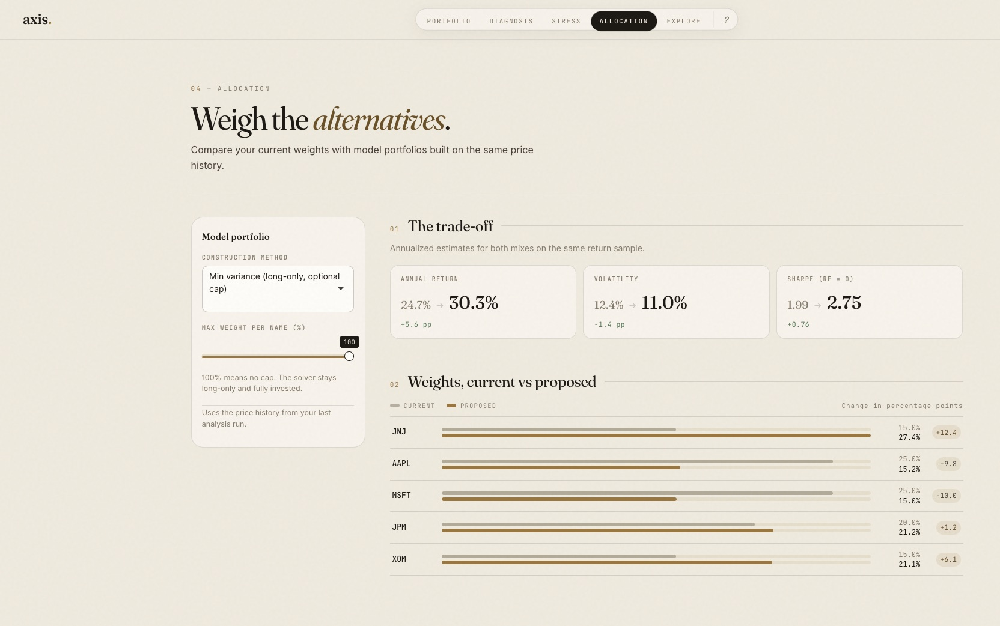

# Axis

**A Shiny workspace for self-directed investors who want to stress-test a portfolio—weights, benchmark, and risk—in one place before they commit to a story about “why this allocation.”**

*GitHub:* [nakim12/axis](https://github.com/nakim12/axis) · *Live:* [axis.nakim.me](https://axis.nakim.me/)



---

## What is it?

**Axis** is a Shiny app in the browser. You define a **weighted portfolio** (tickers and weights, or a **sample template**), choose a **benchmark** such as SPY or QQQ, and pull a shared history of adjusted prices from Yahoo Finance. From there:

- **Diagnosis** reads the portfolio's risk: headline KPIs, plain-language insights tagged with a **confidence level**, performance and rolling metrics against the benchmark, concentration and risk contribution, holding and sector attribution, and exports.
- **Stress** replays historical episodes (COVID crash, 2022 sell-off, Q4 2018, and more), applies an optional mechanical daily return shock, and draws a **bootstrap fan** of forward paths.
- **Allocation** compares your weights with long-only model portfolios (min variance on sample or Ledoit-Wolf shrunk covariance, inverse vol, equal weight, max Sharpe), all under the same optional weight cap, on the same window.
- **Explore** looks at single names outside the portfolio: price trends and returns, exploratory ARIMA forecasts, and per-ticker risk.
- **Methodology** (the **?** in the nav) documents every formula and its limits.

It is built for questions like: *How does this mix behave versus a simple passive alternative, where are the pressure points, and what happens in rough historical patches?*

---

## What problem does this solve?

Brokerage apps show **positions** and **P&L**. They rarely help you **compare your actual allocation** to a baseline, **see portfolio-level drawdowns and correlations**, or **replay how a basket would have behaved** over a chosen history. This project is a **research sandbox**: you supply the thesis (tickers + weights), and the app returns transparent metrics and charts—**educational tooling, not financial advice.**

---

## How the session flows

1. **Portfolio** — Tickers and weights (normalized to 100%), or one of four sample templates; a benchmark (SPY, QQQ, VTI, DIA) and an analysis window. Holdings show as a weighted ledger with allocation bars by holding and by sector. You can **download or load a portfolio JSON** snapshot to reuse or share a setup.
2. **Load** — Daily adjusted prices via Yahoo Finance (`quantmod`) for the window you picked.
3. **Diagnosis** — Risk and return in numbers and in plain language. Each insight is tagged **high**, **medium**, or **low** confidence depending on what it rests on and how much history backs it. One **Export** menu covers the full report (.zip), a text summary, and metrics/attribution CSVs. **Pins** (session-only) compare the headline metrics before and after you change the portfolio.
4. **Stress and Allocation** — Historical episodes, bps shocks, and the bootstrap fan; then the trade-off between your weights and a model portfolio, with current vs proposed weights side by side.
5. **Explore and Methodology** — Per-ticker views, and the definitions behind every number.

Everything stays in one Shiny session so you are not jumping between spreadsheets and disconnected chart tools.

| | |
|---|---|
|  |  |
|  |  |

---

## Design

The interface uses an “observatory” theme: parchment, ink, and brass, with Fraunces for display type, Inter for UI text, and JetBrains Mono for numbers. The landing page is a scrollable story inside the Shiny app, anchored by an animated armillary sphere drawn on a canvas. Charts share the same palette and fonts through a ggplot theme rendered with `ragg`.

The app respects `prefers-reduced-motion` (the sphere draws a single still frame and loaders stop animating) and adapts to phone widths, with wide tables scrolling inside their cards.

---

## Architecture

```
┌──────────────────────────────────────────────────────────────┐
│  Shiny client (browser)                                      │
│  Navbar: Portfolio · Diagnosis · Stress · Allocation ·       │
│          Explore · ? (Methodology); wordmark returns Home    │
│  www/: CSS design tokens, landing sphere + page JS           │
└─────────────────────────────┬────────────────────────────────┘
                              │ reactive inputs + outputs
                              ▼
┌──────────────────────────────────────────────────────────────┐
│  app.R (entry) + R/ modules                                  │
│  global.R loads: config · helpers · plot_theme · app_theme · │
│  page_ui · portfolio · snapshots · scenarios · allocation ·  │
│  landing_ui · methodology_ui · app_ui · app_server           │
└─────────────────────────────┬────────────────────────────────┘
                              │ getSymbols / merges / stats
                              ▼
┌──────────────────────────────────────────────────────────────┐
│  Market data (Yahoo Finance, via quantmod)                   │
└──────────────────────────────────────────────────────────────┘
```

---

## Tech stack

| Layer | Technology |
|-------|------------|
| App runtime | [R](https://www.r-project.org/) + [Shiny](https://shiny.posit.co/), `bslib` (Bootstrap 5) |
| Data | `quantmod`, `zoo` |
| Analytics | `dplyr`, `tidyr`, `reshape2`, `forecast`, `quadprog`, `jsonlite` |
| Charts | `ggplot2`, `scales`, rendered with `ragg`; bundled fonts registered via `systemfonts` |
| Front end | Plain CSS and JS in `www/` (no build step); Shiny's built-in busy indicators |
| CI deploy | GitHub Actions → [shinyapps.io](https://www.shinyapps.io/) (`rsconnect`) |
| Static sibling | `Investment Performance Tracker.Rmd` (original report-style analysis; not required to run the app) |

Dependencies for local runs and CI are declared in `DESCRIPTION`.

---

## Repository layout

```
axis/
├── app.R                         # Shiny entry (calls app_ui / app_server from R/)
├── global.R                      # Sources all modules in R/ (runs before app.R)
├── DESCRIPTION                   # Package imports (used by Actions for deps)
├── R/
│   ├── config.R                  # Sectors, sample portfolios, benchmarks
│   ├── eval_config.R             # Fixed evaluation universes, dates, defaults
│   ├── metrics.R                 # Return and risk metric definitions
│   ├── helpers.R
│   ├── plot_theme.R              # ggplot theme, palette, font registration
│   ├── app_theme.R               # <head> assets, busy indicators, asset versioning
│   ├── page_ui.R                 # Shared page layout: header, rail, sections, cards
│   ├── portfolio.R               # Portfolio metrics, attribution, insights
│   ├── snapshots.R               # JSON snapshots, diagnosis pin compare helpers
│   ├── scenarios.R               # Stress presets & shock helpers
│   ├── allocation.R              # Long-only optimizers (quadprog), Ledoit-Wolf shrinkage
│   ├── landing_ui.R              # Home / landing page
│   ├── methodology_ui.R          # Methodology copy
│   ├── app_ui.R                  # navbarPage UI definition
│   └── app_server.R              # Main server function
├── www/
│   ├── css/                      # tokens.css, app.css, landing.css
│   ├── js/                       # app.js, landing.js (armillary sphere)
│   └── img/axis-spinner.svg      # Loading indicator
├── fonts/                        # Inter and JetBrains Mono for charts
├── data/eval/                    # Frozen evaluation prices + risk-free (see MANIFEST.md)
├── tests/testthat/               # Unit tests (run in CI before deploy)
├── docs/screenshots/             # README images
├── site/                         # axis.nakim.me wrapper page (Vercel)
├── scripts/
│   ├── build_eval_data.R         # Rebuilds data/eval/ (changes every reported number)
│   └── deploy_shinyapps.R        # CI / manual publish helper
├── .github/workflows/            # Deploy workflow
├── Investment Performance Tracker.Rmd
└── Investment Performance Tracker.Rproj
```

---

## Run locally

**Prerequisites:** R 4.x, RStudio optional. Production builds with R 4.5.3 and current CRAN packages; older local `bslib` versions render a few details differently, so keep `bslib` and `shiny` up to date when working on styling.

1. Install dependencies (from R, at the project root):

   ```r
   install.packages(c(
     "shiny", "bslib", "quantmod", "zoo", "forecast", "dplyr", "tidyr",
     "reshape2", "ggplot2", "scales", "ragg", "systemfonts", "quadprog", "jsonlite"
   ))
   ```

   Or use `pak::local_install_dev_deps()` / `remotes::install_deps()` if you treat the folder as a package.

2. Launch the app:

   ```r
   shiny::runApp()
   ```

   Or open `app.R` in RStudio and click **Run App**. Keep the working directory at the project root so **`global.R`** loads the `R/` modules before **`app.R`**.

After editing anything in `www/`, bump `ASSET_VERSION` in `R/app_theme.R` so browsers fetch the new files instead of cached ones.

---

## Live demo

**[axis.nakim.me](https://axis.nakim.me/)**

The app is hosted on [shinyapps.io](https://nathankim.shinyapps.io/investment-performance-tracker/); `site/` is a one-page wrapper, deployed on Vercel, that serves it at the custom domain.

---

## Tests

Unit tests in `tests/testthat/` check the risk metrics, the optimizers, and attribution against hand-computed values. The Ledoit-Wolf estimator is also checked against a loop-by-loop transcription of the paper's formulas. Run them from the project root:

```r
testthat::test_dir("tests/testthat")
```

---

## Deploy from GitHub

GitHub Actions runs the tests on every push that touches app code (`app.R`, `global.R`, `R/`, `www/`, `fonts/`, `data/`, `tests/`, `DESCRIPTION`, or the deploy script and workflow). On `main`, it then deploys, but only if every test passed. The workflow pins R to a version shinyapps.io supports. Secrets and manual runs are documented in [`.github/DEPLOY_SHINYAPPS.md`](.github/DEPLOY_SHINYAPPS.md).

---

## Disclaimer

**Educational use only.** Nothing here is investment, tax, or legal advice. Past performance and backtests do not guarantee future results. You are responsible for your own decisions.

---

## Author

**Nathan Kim**  
[GitHub](https://github.com/nakim12) · [LinkedIn](https://linkedin.com/in/kim-a-nathan)
